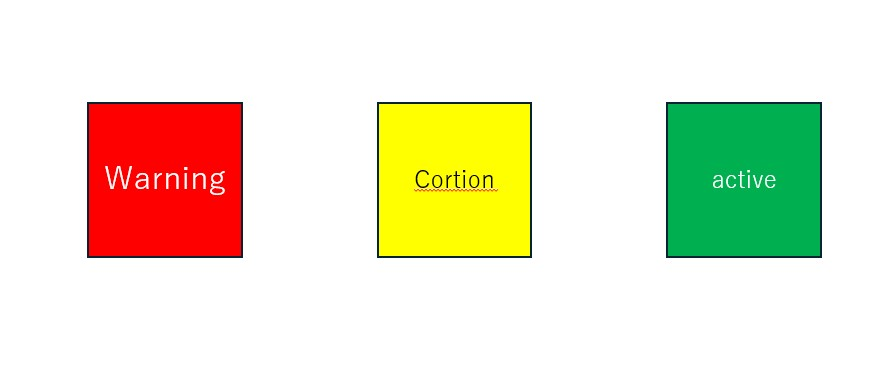

# ページ構成（理想）
clickBox用のテストページ
四角の配列でクリックしたら音が出る仕組み
→DBのフラグを見て音を出す仕組み、もしくは、APIから叩いてもらうことはできないか？

## SoundBoxSet

### 欲しい機能
#### 1page - 描画 
* Drumをクリックもしくは、Keyイベントで演奏 
Boxは３色
+ 赤：クラッシュシンバル
+ 黄：ハイハット
+ 緑：タム

+ スネア
+ Hiタム
+ Loタム
+ フロアタム
+ バスドラム

#### 2page - 状態確認

* 設定名称一覧

*****

### 利用音源
* soundNoteの音源：[魔王魂](https://maou.audio/category/se/se-inst/page/4/ "楽器音 _ フリー効果音無料ダウンロード 魔王魂.html")

### 参考サイト
* [Online drum machine](https://www.musicca.com/drum-machine?data=90-n-44-a--5acegikm6em7acdfgjk-5e "Online drum machine | MUSICCA")
* [Virtual drums](https://www.musicca.com/drum-machine?data=90-n-44-a-12-3a5acegikmo6em7ai- "Virtual drum | MUSICCA")
